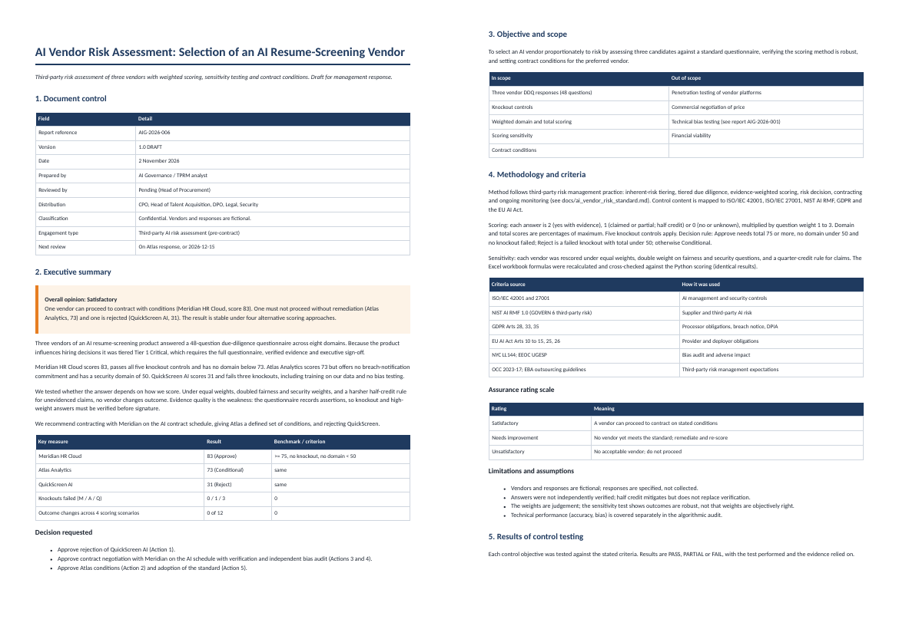

# AI Vendor Risk Assessment: Third-Party Due Diligence, Scoring and Contract Conditions

A third-party risk management toolkit for buying AI: inherent-risk tiering, a 48-question scored due-diligence questionnaire, a three-vendor assessment with sensitivity testing, an AI vendor risk standard and contract schedule.



> All data, vendors, companies and schools are **synthetic or fictional**. The method, instruments and code are real and reproducible. Findings describe the simulated systems, not real products.

## How a GRC specialist approaches this

| Step | What was done |
|---|---|
| Overall approach | TPRM lifecycle: intake and tiering, tiered due diligence, evidence-weighted scoring, decision rule with knockouts, contracting, monitoring and exit. |
| Frameworks | ISO/IEC 42001 and 27001; NIST AI RMF GOVERN 6; GDPR Arts 28, 33, 35; EU AI Act Arts 10 to 15, 25, 26; NYC LL144; OCC 2023-17 third-party risk. |
| Quantitative tests | Weighted domain and total scoring; 5 knockout controls; sensitivity under equal weights, doubled fairness and security weights, and a harsher claims rule; Excel formulas recalculated in LibreOffice and cross-checked to Python. |
| Governance tools | Inherent-risk intake workbook (auto tier), DDQ workbook (dropdowns, formulas, evidence list), completed example, risk acceptance form. |

## Result

- **Recommendation:** contract with Meridian HR Cloud (83) on conditions; give Atlas Analytics (73, fails breach-notification knockout, security domain 50) defined conditions; **reject QuickScreen AI** (31, fails three knockouts including training on our data).
- **Outcomes do not change under any of four scoring scenarios** (12 vendor-scenario pairs), so the decision does not depend on the weights.
- The weak point is evidence quality, not scoring: unevidenced claims get half credit, and knockout and weight-3 answers must be verified before signature.
- QA finding: Excel and Python initially disagreed on rounding (banker's rounding vs half up); fixed and re-verified.

## Deliverables

| File | Purpose |
|---|---|
| `docs/AI_Vendor_Risk_Assessment_Report.pdf` | Assessment report (also .docx and .md) |
| `docs/AI_Vendor_DDQ.xlsx` | The questionnaire (blank) |
| `docs/examples/Atlas_Analytics_completed_DDQ.xlsx` | Completed, recalculated example |
| `docs/AI_Vendor_Inherent_Risk_Intake.xlsx` | Tiering workbook for business owners |
| `docs/ai_vendor_risk_standard.md` | The standard (lifecycle, tiers, decision rule, RACI) |
| `docs/contract_ai_schedule.md, docs/risk_acceptance_form.md` | Contract clauses and exception form |
| `ddq_content.py, score.py, build_workbooks.py` | Source of questions, scoring engine, workbook builder and verifier |

## Reproduce

```bash
pip install -r requirements.txt
python3 score.py && python3 build_workbooks.py && python3 build_report.py
```
PDF export needs Node with Playwright (`npx playwright install chromium`). Workbook verification in project 6 needs LibreOffice.

## Limits

Synthetic data and simulated systems. Thresholds and weights are stated assumptions shown in the code so they can be challenged. This is not legal, clinical or financial advice, and governance controls that need vendor evidence are marked NOT TESTED in the report rather than assumed.
