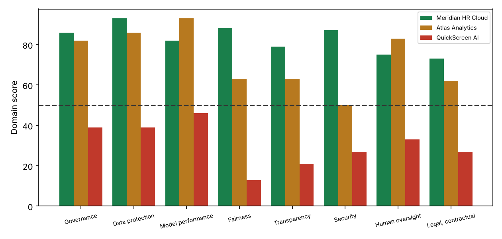
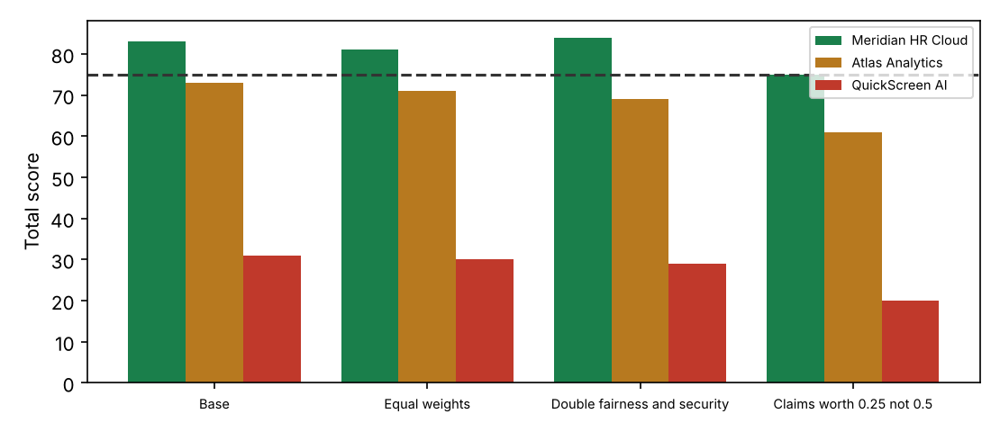

# AI Vendor Risk Assessment: Selection of an AI Resume-Screening Vendor
*Third-party risk assessment of three vendors with weighted scoring, sensitivity testing and contract conditions. Draft for management response.*

## 1. Document control

| Field | Detail |
|---|---|
| Report reference | AIG-2026-006 |
| Version | 1.0 DRAFT |
| Date | 2 November 2026 |
| Prepared by | AI Governance / TPRM analyst |
| Reviewed by | Pending (Head of Procurement) |
| Distribution | CPO, Head of Talent Acquisition, DPO, Legal, Security |
| Classification | Confidential. Vendors and responses are fictional. |
| Engagement type | Third-party AI risk assessment (pre-contract) |
| Next review | On Atlas response, or 2026-12-15 |

## 2. Executive summary

> **Overall opinion: Satisfactory**  
> One vendor can proceed to contract with conditions (Meridian HR Cloud, score 83). One must not proceed without remediation (Atlas Analytics, 73) and one is rejected (QuickScreen AI, 31). The result is stable under four alternative scoring approaches.

Three vendors of an AI resume-screening product answered a 48-question due-diligence questionnaire across eight domains. Because the product influences hiring decisions it was tiered Tier 1 Critical, which requires the full questionnaire, verified evidence and executive sign-off.

Meridian HR Cloud scores 83, passes all five knockout controls and has no domain below 73. Atlas Analytics scores 73 but offers no breach-notification commitment and has a security domain of 50. QuickScreen AI scores 31 and fails three knockouts, including training on our data and no bias testing.

We tested whether the answer depends on how we score. Under equal weights, doubled fairness and security weights, and a harsher half-credit rule for unevidenced claims, no vendor changes outcome. Evidence quality is the weakness: the questionnaire records assertions, so knockout and high-weight answers must be verified before signature.

We recommend contracting with Meridian on the AI contract schedule, giving Atlas a defined set of conditions, and rejecting QuickScreen.

| Key measure | Result | Benchmark / criterion |
|---|---|---|
| Meridian HR Cloud | 83 (Approve) | >= 75, no knockout, no domain < 50 |
| Atlas Analytics | 73 (Conditional) | same |
| QuickScreen AI | 31 (Reject) | same |
| Knockouts failed (M / A / Q) | 0 / 1 / 3 | 0 |
| Outcome changes across 4 scoring scenarios | 0 of 12 | 0 |

### Decision requested

- Approve rejection of QuickScreen AI (Action 1).
- Approve contract negotiation with Meridian on the AI schedule with verification and independent bias audit (Actions 3 and 4).
- Approve Atlas conditions (Action 2) and adoption of the standard (Action 5).

## 3. Objective and scope

To select an AI vendor proportionately to risk by assessing three candidates against a standard questionnaire, verifying the scoring method is robust, and setting contract conditions for the preferred vendor.

| In scope | Out of scope |
|---|---|
| Three vendor DDQ responses (48 questions) | Penetration testing of vendor platforms |
| Knockout controls | Commercial negotiation of price |
| Weighted domain and total scoring | Technical bias testing (see report AIG-2026-001) |
| Scoring sensitivity | Financial viability |
| Contract conditions |  |

## 4. Methodology and criteria

Method follows third-party risk management practice: inherent-risk tiering, tiered due diligence, evidence-weighted scoring, risk decision, contracting and ongoing monitoring (see docs/ai_vendor_risk_standard.md). Control content is mapped to ISO/IEC 42001, ISO/IEC 27001, NIST AI RMF, GDPR and the EU AI Act.

Scoring: each answer is 2 (yes with evidence), 1 (claimed or partial; half credit) or 0 (no or unknown), multiplied by question weight 1 to 3. Domain and total scores are percentages of maximum. Five knockout controls apply. Decision rule: Approve needs total 75 or more, no domain under 50 and no knockout failed; Reject is a failed knockout with total under 50; otherwise Conditional.

Sensitivity: each vendor was rescored under equal weights, double weight on fairness and security questions, and a quarter-credit rule for claims. The Excel workbook formulas were recalculated and cross-checked against the Python scoring (identical results).

| Criteria source | How it was used |
|---|---|
| ISO/IEC 42001 and 27001 | AI management and security controls |
| NIST AI RMF 1.0 (GOVERN 6 third-party risk) | Supplier and third-party AI risk |
| GDPR Arts 28, 33, 35 | Processor obligations, breach notice, DPIA |
| EU AI Act Arts 10 to 15, 25, 26 | Provider and deployer obligations |
| NYC LL144; EEOC UGESP | Bias audit and adverse impact |
| OCC 2023-17; EBA outsourcing guidelines | Third-party risk management expectations |

### Assurance rating scale

| Rating | Meaning |
|---|---|
| Satisfactory | A vendor can proceed to contract on stated conditions |
| Needs improvement | No vendor yet meets the standard; remediate and re-score |
| Unsatisfactory | No acceptable vendor; do not proceed |

### Limitations and assumptions

- Vendors and responses are fictional; responses are specified, not collected.
- Answers were not independently verified; half credit mitigates but does not replace verification.
- The weights are judgement; the sensitivity test shows outcomes are robust, not that weights are objectively right.
- Technical performance (accuracy, bias) is covered separately in the algorithmic audit.

## 5. Results of control testing

Each control objective was tested against the stated criteria. Results are PASS, PARTIAL or FAIL, with the test performed and the evidence relied on.

| Ref | Control objective | Test performed | Result | Evidence / finding |
|---|---|---|---|---|
| K-01 | Knockout P01: Is our data excluded from training or tuning any model used for others, by default? | DDQ response and evidence for 3 vendors | PARTIAL | Meridian Yes; Atlas Yes; QuickScreen No |
| K-02 | Knockout P02: Is there a DPA covering AI processing and cross-border transfers? | DDQ response and evidence for 3 vendors | PASS | Meridian Yes; Atlas Yes; QuickScreen Claim |
| K-03 | Knockout F01: Has the system been tested for discriminatory impact on protected groups? | DDQ response and evidence for 3 vendors | PARTIAL | Meridian Yes; Atlas Yes; QuickScreen No |
| K-04 | Knockout S04: Will you notify us of breaches within 72 hours or less? | DDQ response and evidence for 3 vendors | PARTIAL | Meridian Yes; Atlas No; QuickScreen No |
| K-05 | Knockout H01: Can a human review and override any consequential output, with overrides logged? | DDQ response and evidence for 3 vendors | PASS | Meridian Yes; Atlas Yes; QuickScreen Claim |
| V-01 | Vendor total at least 75% with no domain under 50% | Weighted scoring of 48 questions | PARTIAL | Meridian 83; Atlas 73; QuickScreen 31 |
| V-02 | Outcome stable under alternative weights | 4 scenarios x 3 vendors | PASS | No vendor changes outcome in any scenario |
| V-03 | Responses supported by evidence | Share of answers that are unevidenced claims or No | PARTIAL | Meridian 18 claims, 0 no; Atlas 24 claims, 2 no; QuickScreen 21 claims, 23 no |

*Figure 1. Domain scores by vendor (dashed line: 50 minimum)*

*Figure 2. Total score under four scoring scenarios (dashed line: 75 approval threshold)*

## 6. Detailed findings

### F1  QuickScreen AI must be rejected: three mandatory controls are absent  [Critical]

| Field | Detail |
|---|---|
| **Rating** | Critical |
| **Condition (what we found)** | QuickScreen scores 31 (outcome Reject) and fails knockouts P01, F01, S04: our data is not excluded from model training, no bias testing is evidenced and no breach-notification commitment is offered. 23 of 48 answers are No and 21 are unevidenced claims; the lowest domain scores 13. |
| **Criteria (what should be)** | Knockout controls are mandatory for any Tier 1 or Tier 2 AI vendor (this standard). GDPR Arts 28 and 33; NYC LL144 bias audit; EU AI Act Art 10. |
| **Cause** | Early-stage vendor with no AI governance programme. |
| **Effect (risk)** | Unacceptable data protection, legal and discrimination risk. |
| **Recommendation** | Reject. Reconsider only after a documented remediation and a fresh DDQ. |
| **Framework references** | GDPR; NYC LL144; EU AI Act |
| **Owner / target** | Head of Procurement / 2026-11-16 |

### F2  Atlas Analytics is conditional: no breach-notification commitment and weak security evidence  [High]

| Field | Detail |
|---|---|
| **Rating** | High |
| **Condition (what we found)** | Atlas scores 73 (Conditional). It fails knockout S04 (breach notification) and its security domain is 50, with AI-specific attack testing and access review unevidenced. Fairness and transparency domains are 63 and 63, supported mainly by claims. |
| **Criteria (what should be)** | Breach notification within 72 hours; independent security assurance (ISO 27001 / SOC 2) and AI-specific security testing for Tier 2 or higher. |
| **Cause** | Mature analytics vendor, but AI-specific governance is thin. |
| **Effect (risk)** | Delayed breach awareness; unverified resilience. |
| **Recommendation** | Do not contract unless the vendor (1) accepts the 72-hour clause, (2) supplies a SOC 2 or ISO 27001 report and red-team summary, and (3) evidences fairness testing. Re-score before signature. |
| **Framework references** | GDPR Art 33; ISO 27001; OWASP LLM Top 10 |
| **Owner / target** | Procurement / Security / 2026-12-15 |

### F3  Meridian HR Cloud is the preferred vendor, with conditions on remaining unevidenced items  [Medium]

| Field | Detail |
|---|---|
| **Rating** | Medium |
| **Condition (what we found)** | Meridian scores 83 (Approve) with no knockouts failed and a lowest domain of 73. It is the strongest vendor on every sensitivity scenario (75 to 84). 2 high-weight items are still claims or gaps: M03 (Report accuracy by relevant subgroups and conditio...); L03 (Audit rights and right to documentation on request...). |
| **Criteria (what should be)** | High-weight controls should be evidenced before contract; otherwise they become contract obligations with verification rights. |
| **Cause** | Normal pre-contract evidence gaps. |
| **Effect (risk)** | Residual risk accepted only if converted to obligations. |
| **Recommendation** | Contract on the AI schedule (docs/contract_ai_schedule.md); verify the listed items within 60 days of signing; independent bias audit before go-live. |
| **Framework references** | ISO 42001 8; NIST GOVERN 6 |
| **Owner / target** | Procurement / Legal / 2026-12-15 |

### F4  Vendor self-assertion is the main evidence quality problem  [High]

| Field | Detail |
|---|---|
| **Rating** | High |
| **Condition (what we found)** | Share of answers that are unevidenced claims or No: Meridian HR Cloud 37%; Atlas Analytics 54%; QuickScreen AI 91%. Unsupported claims receive half credit by design. |
| **Criteria (what should be)** | Evidence over assertion (ISO 19011 audit principle; SIG/CAIQ practice). |
| **Cause** | Questionnaire answers are easy to give and hard to verify. |
| **Effect (risk)** | Scores overstate assurance. |
| **Recommendation** | For Tier 1 and 2, verify at least all knockout and weight-3 answers against documents or a live demonstration; sample 20% of the rest. |
| **Framework references** | ISO 19011 |
| **Owner / target** | Procurement / 2027-01-31 |

### F5  No intake tiering existed, so due-diligence depth was not proportionate  [Medium]

| Field | Detail |
|---|---|
| **Rating** | Medium |
| **Condition (what we found)** | Three vendors were engaged before the use case was risk-tiered. A tiering intake (docs/AI_Vendor_Inherent_Risk_Intake.xlsx) now places an AI hiring tool in Tier 1 Critical, which requires the full DDQ, verified evidence and executive sign-off. |
| **Criteria (what should be)** | Depth of due diligence must be proportionate to inherent risk (third-party risk management practice; OCC 2023-17; EBA outsourcing guidelines). |
| **Cause** | No AI-specific procurement gate. |
| **Effect (risk)** | Late discovery of unacceptable vendors, wasted effort. |
| **Recommendation** | Make the intake workbook a mandatory first step; link procurement systems so no AI contract is signed without a tier and score. |
| **Framework references** | ISO 42001 8.x; OCC 2023-17 |
| **Owner / target** | Head of Procurement / 2027-01-31 |

## 7. Risk assessment

Risks are scored on a 5 by 5 likelihood and impact matrix. Inherent risk assumes no controls. Residual risk assumes the controls currently in place. Bands: 20 to 25 Critical, 12 to 19 High, 6 to 11 Medium, 1 to 5 Low.

| ID | Risk | Inherent | Existing controls | Residual | Owner | Treatment |
|---|---|---|---|---|---|---|
| R1 | Contracting with a non-compliant AI vendor | 4x5=20 (Critical) | DDQ, knockouts | 2x5=10 (Medium) | Head of Procurement | Mitigate: reject Z, condition A |
| R2 | Verified evidence differs from vendor claims | 4x4=16 (High) | Half credit for claims | 3x4=12 (High) | Procurement | Mitigate: verification sampling |
| R3 | Vendor changes model after contract | 4x4=16 (High) | None | 2x4=8 (Medium) | Legal | Mitigate: change-notice clause, re-audit trigger |
| R4 | Vendor trains on our data | 3x5=15 (High) | Knockout P01 | 2x5=10 (Medium) | DPO | Mitigate: contract prohibition |
| R5 | Lock-in; weak exit | 3x3=9 (Medium) | Exit plan question | 3x3=9 (Medium) | Procurement | Mitigate: data return and transition assistance |
| R6 | Scoring weights drive outcomes | 3x3=9 (Medium) | Sensitivity test | 1x3=3 (Low) | GRC | Accept: outcomes stable across scenarios |

## 8. Recommendations and action plan

| # | Action | Addresses | Priority | Owner | Target date |
|---|---|---|---|---|---|
| 1 | Reject QuickScreen AI; record rationale | F1 | Immediate | Head of Procurement | 2026-11-16 |
| 2 | Issue Atlas conditions; re-score on response | F2 | High | Procurement / Security | 2026-12-15 |
| 3 | Negotiate Meridian on the AI contract schedule | F3 | High | Legal | 2026-12-15 |
| 4 | Verify Meridian weight-3 and knockout evidence; commission independent bias audit before go-live | F3 F4 | High | GRC / Procurement | 2027-01-15 |
| 5 | Adopt intake tiering, DDQ and risk-acceptance form as mandatory procurement controls | F5 | Medium | Head of Procurement | 2027-01-31 |
| 6 | Set reassessment cadence by tier and monitor vendor changes | R3 | Medium | GRC | 2027-03-31 |

## 9. Management response

Responses below are drafted for the accountable owner to confirm, amend or reject. An accepted risk requires a named executive signature and an expiry date.

| Finding | Proposed response | Accept / Amend / Reject | Owner sign-off |
|---|---|---|---|
| F1 | Agree. Vendor informed. | Pending | Pending |
| F2 | Agree. Conditions issued to vendor. | Pending | Pending |
| F3 | Agree. | Pending | Pending |
| F4 | Agree. | Pending | Pending |
| F5 | Agree. Adopted as standard. | Pending | Pending |

## 10. Appendices

### Appendix A. Domain scores

| Domain | Meridian HR Cloud | Atlas Analytics | QuickScreen AI |
|---|---|---|---|
| Governance | 86 | 82 | 39 |
| Data protection | 93 | 86 | 39 |
| Model performance | 82 | 93 | 46 |
| Fairness | 88 | 63 | 13 |
| Transparency | 79 | 63 | 21 |
| Security | 87 | 50 | 27 |
| Human oversight | 75 | 83 | 33 |
| Legal, contractual | 73 | 62 | 27 |
| TOTAL | 83 | 73 | 31 |
| Knockouts failed | none | S04 | P01, F01, S04 |
| Outcome | Approve | Conditional | Reject |

### Appendix B. Sensitivity

| Scenario | Meridian HR Cloud | Atlas Analytics | QuickScreen AI |
|---|---|---|---|
| Base | 83 (Approve) | 73 (Conditional) | 31 (Reject) |
| Equal weights | 81 (Approve) | 71 (Conditional) | 30 (Reject) |
| Double fairness and security | 84 (Approve) | 69 (Conditional) | 29 (Reject) |
| Claims worth 0.25 not 0.5 | 75 (Approve) | 61 (Conditional) | 20 (Reject) |

### Appendix C. Meridian items to verify or contract for

| ID | Question | Weight | Answer |
|---|---|---|---|
| G03 | Maintain an AI system inventory and risk assessment for this product, reviewed at least annually? | 2 | Claim |
| G06 | Describe independent assurance of AI releases (internal review board or external audit). | 2 | Claim |
| P06 | Is special-category data inferred or processed? How is it controlled? | 2 | Claim |
| M03 | Report accuracy by relevant subgroups and conditions with sample sizes. | 3 | Claim |
| M04 | Describe drift detection and revalidation after changes. | 2 | Claim |
| F05 | Describe your remediation process when bias is found. | 2 | Claim |
| T03 | Are model changes communicated in advance, with the ability to stay on a prior version? | 2 | Claim |
| T05 | Do you provide exportable logs for audit? | 2 | Claim |
| S03 | Role-based access to our data, logged and reviewed? | 2 | Claim |
| S05 | Tested business continuity and exit plan? | 2 | Claim |
| H03 | Kill switch or ability to suspend features quickly? | 2 | Claim |
| H05 | Do you disclose incidents affecting other customers where relevant to us? | 2 | Claim |
| H06 | Do you provide a candidate or user appeal route support? | 2 | Claim |
| L02 | Liability for AI errors and IP/data indemnity addressed? | 2 | Claim |
| L03 | Audit rights and right to documentation on request? | 3 | Claim |
| L04 | Service levels for accuracy, availability and support? | 2 | Claim |

### Appendix D. Companion documents

docs/AI_Vendor_DDQ.xlsx (blank questionnaire), docs/examples/Atlas_Analytics_completed_DDQ.xlsx (completed and recalculated example), docs/AI_Vendor_Inherent_Risk_Intake.xlsx (tiering), docs/ai_vendor_risk_standard.md, docs/contract_ai_schedule.md, docs/risk_acceptance_form.md, ddq_content.py, score.py, build_workbooks.py.
